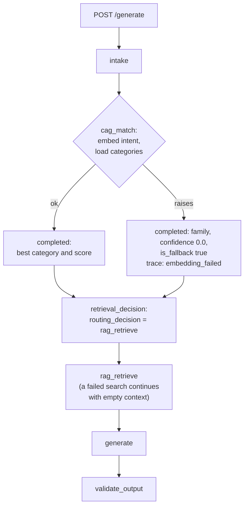
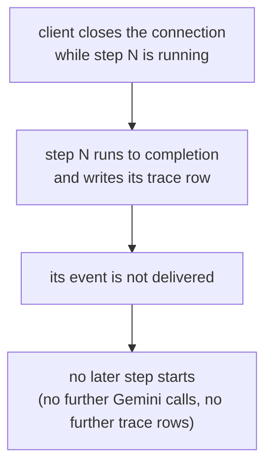
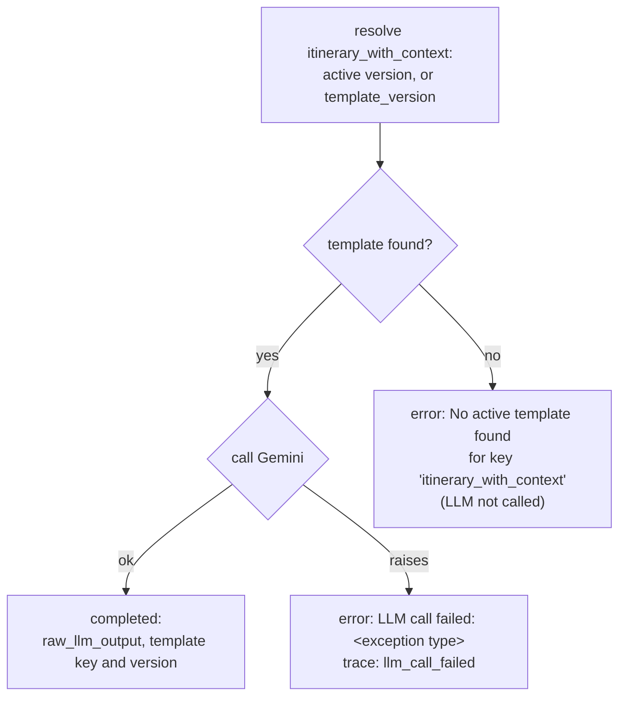
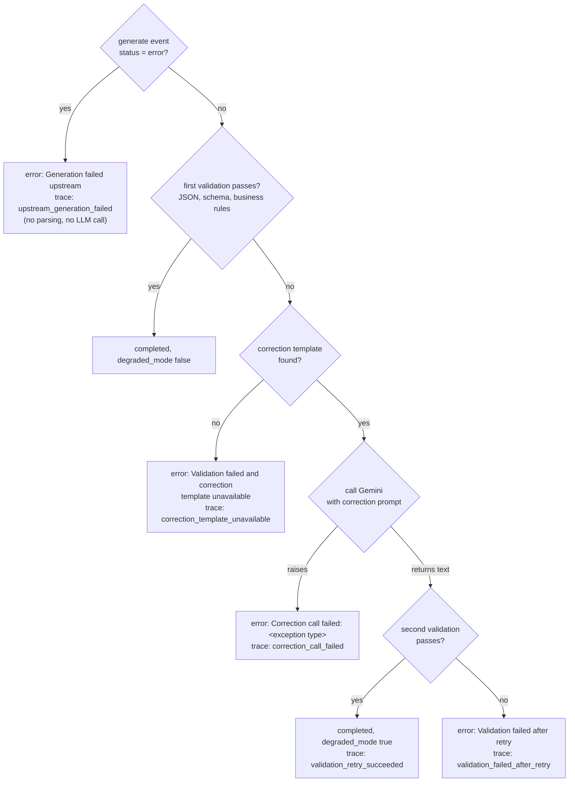

# API Reference

Base URL: `http://localhost:8000`

---

## Endpoints

| Method | Path | Description |
|--------|------|-------------|
| `GET` | `/health` | Liveness probe |
| `POST` | `/generate` | Run the travel itinerary workflow, stream results as SSE |
| `GET` | `/traces/{session_id}` | Fetch persisted trace events for a session |
| `GET` | `/` | Static frontend (HTML) |

---

## GET /health

Returns `200 OK` when the server is running.

```json
{ "status": "ok" }
```

---

## POST /generate

Executes the 6-step CAG + RAG travel itinerary workflow and streams one Server-Sent Event per step.

### Request

**Content-Type:** `application/json`

**Query parameters**

| Parameter | Type | Required | Description |
|-----------|------|----------|-------------|
| `template_version` | integer | No | Pin a specific prompt template version. Omit to use the active version. |

**Body**

| Field | Type | Required | Constraints |
|-------|------|----------|-------------|
| `destination` | string | Yes | One Australian place, in English or Chinese (see "Input guards"). Replaced by its canonical lowercase English name (`"悉尼"` → `"sydney"`). |
| `trip_length` | integer | Yes | 1 to 14 |
| `budget` | string | Yes | One of `"budget"`, `"moderate"`, `"luxury"` |
| `travel_style` | string | Yes | Non-empty free text (e.g. `"family"`, `"adventure"`) |
| `max_daily_budget_aud` | integer | No | Daily budget per person in whole AUD, excluding accommodation; at least 1, no upper bound. Sets the request's daily budget ceiling (see below). A fractional value is a 422 |
| `notes` | string | No | Free text for details the other fields cannot express, added to the retrieval query and to the generation prompt. Surrounding whitespace is stripped, at most 500 characters (longer is a 422), and blank counts as absent |

**Daily budget ceiling.** All costs in the itinerary are AUD per person, excluding accommodation. The ceiling is `max_daily_budget_aud` when given, otherwise the budget level's default: `budget` 70, `moderate` 200, `luxury` none. The amount wins over the level when they seem to disagree (`budget` with 500 a day is accepted, with a ceiling of 500); the level still describes the travel style. The generation prompt states the ceiling, and an itinerary whose total exceeds the ceiling times the number of days fails validation and gets one correction call. Whether an amount is realistic for the destination is not checked.

**Input guards.** After field validation and before the workflow starts, two checks run; neither calls an external API, and a refused request runs no workflow step:

1. **Prompt injection.** `destination`, `travel_style` and `notes` are matched against a configurable list of patterns (English and Chinese, e.g. "ignore previous instructions", "system prompt", `<|im_start|>`, "忽略之前的指令"). A match is refused with reason `input_rejected`.
2. **Destination.** The destination must be in the Australian place list (`data/places/australia.tsv`: Australian places from GeoNames with at least 1,000 people, states and territories, major tourist destinations, and one Chinese name per major place in Simplified and Traditional script). Trailing state, territory or country qualifiers are ignored (`"Sydney, NSW"`, `"Perth, WA, Australia"`). Anything else is refused with reason `destination_out_of_scope`, including:
   - places outside Australia (`"Paris"`);
   - destinations too vague to look up (`"Australia"`, `"the east coast"`);
   - two destinations (`"Sydney, Melbourne"`, `"Tasmania, Victoria"`) — a request plans one destination;
   - small places not in the list (fewer than 1,000 people and not a listed tourist destination), and Chinese names other than the one listed.

   A trailing state is not checked against the place's own state: `"Sydney, Tasmania"` is accepted as `sydney`.

**Example**

```json
{
  "destination": "Sydney",
  "trip_length": 3,
  "budget": "moderate",
  "travel_style": "cultural"
}
```

With version pin:

```
POST /generate?template_version=1
```

### Response

**Content-Type:** `text/event-stream`

The response body is a stream of SSE `data:` lines. Each line is a JSON object. The stream emits one event per workflow step in this order:

1. `intake`
2. `cag_match`
3. `retrieval_decision`
4. `rag_retrieve`
5. `generate`
6. `validate_output`

### SSE event envelope

Every event shares the same outer shape:

```json
{
  "session_id": "xxxxxxxx-xxxx-xxxx-xxxx-xxxxxxxxxxxx",
  "step":       "<step name>",
  "status":     "completed" | "error",
  "timestamp":  "2026-04-08T04:12:01.123456+00:00",
  "data":       { ... },
  "error":      null | "<error message>"
}
```

| Field | Type | Notes |
|-------|------|-------|
| `session_id` | string (UUID) | Unique ID for this request. Present on every event. |
| `step` | string | Step name. See per-step sections below. |
| `status` | string | `"completed"` or `"error"` |
| `timestamp` | string (ISO 8601) | UTC timestamp when the event was emitted. |
| `data` | object | Step-specific payload. |
| `error` | string \| null | Error detail when `status` is `"error"`, otherwise `null`. |

---

### Step events — `data` field contents

#### `intake`

Input fields after normalisation, validation and the input guards: `destination` is the canonical name from the place list, and `max_daily_budget_aud` and `notes` are `null` when the request has none.

```json
{
  "session_id": "xxxxxxxx-xxxx-xxxx-xxxx-xxxxxxxxxxxx",
  "step":       "intake",
  "status":     "completed",
  "timestamp":  "2026-04-08T04:12:01.123456+00:00",
  "data": {
    "destination":          "sydney",
    "trip_length":          3,
    "budget":               "moderate",
    "travel_style":         "cultural",
    "max_daily_budget_aud": null,
    "notes":                null
  },
  "error": null
}
```

#### `cag_match`

Result of embedding-based intent classification against `itinerary_categories`.

```json
{
  "session_id": "xxxxxxxx-xxxx-xxxx-xxxx-xxxxxxxxxxxx",
  "step":       "cag_match",
  "status":     "completed",
  "timestamp":  "2026-04-08T04:12:02.234567+00:00",
  "data": {
    "matched_category":  "cultural",
    "confidence_score":  0.91,
    "tone":              "curious and immersive",
    "constraints":       "Prioritise museums, galleries, heritage sites, performing arts, and Indigenous cultural experiences.",
    "is_fallback":       false
  },
  "error": null
}
```

| Field | Type | Notes |
|-------|------|-------|
| `matched_category` | string | `category_key` of the best-matching row |
| `confidence_score` | float | Cosine similarity score, 0.0–1.0 |
| `tone` | string | Tone hint from the matched category |
| `constraints` | string | Constraint hint from the matched category |
| `is_fallback` | boolean | `true` when no match exceeded the minimum threshold and the default category was used |

If the embedding call or loading the categories fails, the step still completes with `matched_category` = `"family"`, `confidence_score` = `0.0` and `is_fallback` = `true`, and the request continues as usual; the trace row records `error_type` = `"embedding_failed"`.

#### `retrieval_decision`

The routing step. Every request is routed to `rag_retrieve`: confidence measures similarity to an itinerary category, not whether destination knowledge is needed. A redesigned routing rule may use this step later.

```json
{
  "session_id": "xxxxxxxx-xxxx-xxxx-xxxx-xxxxxxxxxxxx",
  "step":       "retrieval_decision",
  "status":     "completed",
  "timestamp":  "2026-04-08T04:12:02.345678+00:00",
  "data": {
    "routing_decision":  "rag_retrieve",
    "confidence_score":  0.91
  },
  "error": null
}
```

| Field | Type | Notes |
|-------|------|-------|
| `routing_decision` | string | Always `"rag_retrieve"` |
| `confidence_score` | float | The `cag_match` score, for information only |

#### `rag_retrieve`

Top-k source document chunks retrieved from PgVector.

```json
{
  "session_id": "xxxxxxxx-xxxx-xxxx-xxxx-xxxxxxxxxxxx",
  "step":       "rag_retrieve",
  "status":     "completed",
  "timestamp":  "2026-04-08T04:12:03.456789+00:00",
  "data": {
    "retrieved_context": [
      {
        "chunk_id":    "example-chunk-id",
        "destination": "sydney",
        "state":       "New South Wales",
        "title":       "Guide to Sydney",
        "chunk_text":  "Example chunk text: a few sentences about the destination from the knowledge base...",
        "source":      "https://example.com/guide-to-sydney",
        "section":     "See"
      }
    ],
    "chunks_retrieved":  5,
    "query_text":        "cultural travel in sydney",
    "destination_matched": true
  },
  "error": null
}
```

| Field | Type | Notes |
|-------|------|-------|
| `retrieved_context` | array | List of chunk objects. Empty array if retrieval failed (graceful degradation). `state` is `null` for Australia-wide documents, and `source` is a URL or `"handwritten"`. |
| `chunks_retrieved` | integer | Number of chunks returned |
| `query_text` | string | The query string sent to the search: the request's `notes` (if any), `travel_style` and `travel in <destination>` |
| `destination_matched` | boolean | Whether the knowledge base holds chunks for the destination. Retrieval searches that destination plus the Australia-wide documents; when this is false, only the Australia-wide documents |

#### `generate`

Raw LLM response and the prompt template that was used.

```json
{
  "session_id": "xxxxxxxx-xxxx-xxxx-xxxx-xxxxxxxxxxxx",
  "step":       "generate",
  "status":     "completed",
  "timestamp":  "2026-04-08T04:12:06.567890+00:00",
  "data": {
    "raw_llm_output":          "{ \"destination\": \"sydney\", ... }",
    "prompt_template_key":     "itinerary_with_context",
    "prompt_template_version": 4,
    "context_sources": [
      {"id": "S1", "chunk_id": "...", "title": "Sydney", "source": "https://...", "section": "See"}
    ]
  },
  "error": null
}
```

| Field | Type | Notes |
|-------|------|-------|
| `raw_llm_output` | string | Raw text from the LLM before validation |
| `prompt_template_key` | string | Always `"itinerary_with_context"` |
| `prompt_template_version` | integer | The version of the template that was resolved |
| `context_sources` | array | One entry per retrieved chunk placed in the prompt, in order: `id` (the citation id `S1`, `S2`, ...), `chunk_id`, `title`, `source` (URL), `section`. Empty when retrieval returned nothing |

In the prompt each chunk is written as `[S1] <title>` followed by its text, and the model lists, for each day, the ids that day draws on.

On error (template not found):

```json
{
  "session_id": "xxxxxxxx-xxxx-xxxx-xxxx-xxxxxxxxxxxx",
  "step":       "generate",
  "status":     "error",
  "timestamp":  "2026-04-08T04:12:06.567890+00:00",
  "data":       {},
  "error":      "No active template found for key 'itinerary_with_context'"
}
```

There is no fallback template: the LLM is not called.

On error (LLM call failed) the event has the same shape, with `"error": "LLM call failed: <exception type>"`. Only the exception type is included; details stay in the server log.

#### `validate_output`

Validated and structured itinerary. This is the final consumable output.

```json
{
  "session_id": "xxxxxxxx-xxxx-xxxx-xxxx-xxxxxxxxxxxx",
  "step":       "validate_output",
  "status":     "completed",
  "timestamp":  "2026-04-08T04:12:07.678901+00:00",
  "data": {
    "itinerary": {
      "destination":             "sydney",
      "trip_length_days":        3,
      "budget_level":            "moderate",
      "travel_style":            "cultural",
      "daily_itinerary": [
        {
          "day":                   1,
          "morning":               "Visit the Sydney Opera House and join a guided backstage tour.",
          "afternoon":             "Walk across the Harbour Bridge and explore The Rocks heritage precinct.",
          "evening":               "Dinner at a waterfront restaurant in Circular Quay.",
          "estimated_cost_aud":    180.0,
          "sources":               ["S1"]
        },
        {
          "day":                   2,
          "morning":               "Aboriginal Bush Tucker Tour at the Royal Botanic Gardens.",
          "afternoon":             "Art Gallery of NSW — permanent collection and Aboriginal art wing.",
          "evening":               "Live performance at the Sydney Opera House.",
          "estimated_cost_aud":    160.0,
          "sources":               ["S1", "S2"]
        },
        {
          "day":                   3,
          "morning":               "Coastal walk from Bondi Beach to Coogee.",
          "afternoon":             "Sydney Jewish Museum or Museum of Sydney.",
          "evening":               "Dinner in Surry Hills.",
          "estimated_cost_aud":    140.0,
          "sources":               []
        }
      ],
      "total_estimated_cost_aud": 480.0,
      "key_tips": [
        "Book Opera House tours and performances well in advance.",
        "The Opal card covers trains, buses, and ferries — buy one at the airport on arrival.",
        "Many galleries have free entry; check before paying at the door."
      ]
    },
    "degraded_mode": false,
    "citations": {
      "S1": {"title": "Sydney", "source": "https://...", "section": "See"},
      "S2": {"title": "Sydney/City Centre", "source": "https://...", "section": "Do"}
    }
  },
  "error": null
}
```

Each day's `sources` lists the citation ids it draws on, possibly none. `citations` maps every id used in the itinerary to its `title`, `source` and `section` from the `generate` event's `context_sources`, so a client can show the sources under each day.

`degraded_mode: true` means the first LLM response failed validation and a corrective retry was needed — the itinerary is still valid but was produced on the second attempt.

On unrecoverable error (both attempts failed):

```json
{
  "session_id": "xxxxxxxx-xxxx-xxxx-xxxx-xxxxxxxxxxxx",
  "step":       "validate_output",
  "status":     "error",
  "timestamp":  "2026-04-08T04:12:07.678901+00:00",
  "data":       { "degraded_mode": true },
  "error":      "Validation failed after retry: ..."
}
```

Other `validate_output` errors, all with `"data": { "degraded_mode": true }`:

| `error` | Cause |
|---------|-------|
| `"Generation failed upstream"` | The `generate` event has `status` = `"error"`; nothing is validated and no correction call is made |
| `"Correction call failed: <exception type>"` | The first validation failed and the correction LLM call raised |
| `"Validation failed and correction template unavailable: ..."` | The first validation failed and no `validate_output_correction` template is active |

---

### Error responses

| HTTP status | Cause |
|-------------|-------|
| `422 Unprocessable Entity` | The request was refused before the workflow started. Two kinds, told apart by the body (below). |
| `500 Internal Server Error` | `DATABASE_URL` environment variable is not set. |

**Field validation error** — a missing field, an invalid `budget`, `trip_length` outside 1–14, a blank `destination` or `travel_style`, a `max_daily_budget_aud` that is not a whole number of at least 1. FastAPI's default body, a list of errors with no `reason`:

```json
{
  "detail": [
    {"type": "value_error", "loc": ["body", "trip_length"], "msg": "Value error, trip_length must be at most 14", "input": 15, "ctx": {"error": {}}}
  ]
}
```

**Guard refusal** — an input guard refused the request. The body has a `reason` code and a fixed, human-readable `detail`:

```json
{"reason": "destination_out_of_scope", "detail": "Please enter one specific destination in Australia, such as Sydney, Cairns or Tasmania."}
```

| `reason` | `detail` |
|----------|----------|
| `destination_out_of_scope` | `Please enter one specific destination in Australia, such as Sydney, Cairns or Tasmania.` |
| `input_rejected` | `Your request could not be processed. Please rephrase it and try again.` |

The `detail` is fixed per code: it never repeats the submitted input or says which pattern or field matched. Check for `reason` to tell a refusal from a field error.

---

### Failure behaviour

Once the request body is valid, a failure inside the workflow never breaks the stream: every request whose client stays connected ends with a `validate_output` event. To find the cause of a failed request, look for the first event with `status` = `"error"`; the trace rows (`GET /traces/{session_id}`) carry the matching `error_type`. Error messages name only the exception type; the full exception is in the server log.

#### Overview and `cag_match`



An embedding failure is treated as "no match": the request continues with the default category and confidence 0.0. Every request runs `rag_retrieve`.

#### Client disconnects



The stream simply ends; there is no error event, because there is no client left to receive it. In `GET /traces/{session_id}` such a run stops at the step that was running when the client left, so a run without a `validate_output` row was cut short by its client rather than failing.

#### `generate`



#### `validate_output`



"Validation" means JSON parsing, the `ItineraryOutput` schema, and the business rules: the day count (internally and against the requested `trip_length`), daily costs adding up to the total, the total within the request's daily budget ceiling times the days, no opening hours or prices in the text that the retrieved chunks do not state, and every citation id in a day's `sources` being one of the `generate` event's `context_sources` (all `sources` empty when there were none). A failed rule is reported in the correction prompt and, if the correction also fails, in `error` (messages begin `Content guardrail failed:` or `Business rule failed: cost` / `budget` / `unsupported` / `citation`).

Every `validate_output` error event has `"data": { "degraded_mode": true }`. A reply blocked by Gemini's safety filter arrives as empty text, not as an exception, so it ends as "Validation failed after retry".

#### Event sequences

`retrieval_decision` always completes with `routing_decision` = `"rag_retrieve"` and is left out of the table.

| Situation | `cag_match` | `rag_retrieve` | `generate` | `validate_output` |
|---|---|---|---|---|
| Everything works | completed | completed | completed | completed, `degraded_mode` false |
| Gemini fails during embedding | completed (fallback, `embedding_failed`) | completed | completed | completed |
| The search fails | completed | completed, `retrieved_context` empty (logged; no `error_type`) | completed, `context_sources` empty | completed; every day's `sources` empty, `citations` empty |
| Gemini fails during generation (429, 503, network) | completed | completed | error: `LLM call failed: ClientError` | error: `Generation failed upstream` |
| No active `itinerary_with_context` (there is no fallback template) | completed | completed | error: `No active template found for key ...` | error: `Generation failed upstream` |
| First output invalid (schema or a business rule, e.g. a citation id not in `context_sources`), correction valid | completed | completed | completed | completed, `degraded_mode` true |
| First output invalid, correction call fails | completed | completed | completed | error: `Correction call failed: ServerError` |
| First output and correction both invalid | completed | completed | completed | error: `Validation failed after retry: ...` |

---

## GET /traces/{session_id}

Returns all `trace_events` rows written during a workflow run, ordered by `created_at` ascending.

### Path parameters

| Parameter | Type | Description |
|-----------|------|-------------|
| `session_id` | string (UUID) | The `session_id` from any SSE event in the stream. |

### Response

**Content-Type:** `application/json`

```json
[
  {
    "session_id":               "xxxxxxxx-xxxx-xxxx-xxxx-xxxxxxxxxxxx",
    "step_name":                "intake",
    "status":                   "completed",
    "latency_ms":               12.4,
    "prompt_template_key":      null,
    "prompt_template_version":  null,
    "degraded_mode":            null,
    "error_type":               null,
    "created_at":               "2026-04-08T04:12:01.123456"
  },
  {
    "session_id":               "xxxxxxxx-xxxx-xxxx-xxxx-xxxxxxxxxxxx",
    "step_name":                "generate",
    "status":                   "completed",
    "latency_ms":               3201.7,
    "prompt_template_key":      "itinerary_with_context",
    "prompt_template_version":  1,
    "degraded_mode":            null,
    "error_type":               null,
    "created_at":               "2026-04-08T04:12:04.331234"
  }
]
```

| Field | Type | Notes |
|-------|------|-------|
| `step_name` | string | One of the 6 workflow step names |
| `status` | string | `"completed"`, `"error"`, or `"running"` |
| `latency_ms` | float | Wall-clock duration of the step in milliseconds |
| `prompt_template_key` | string \| null | Set only for the `generate` step |
| `prompt_template_version` | integer \| null | Set only for the `generate` step |
| `degraded_mode` | boolean \| null | Set only for the `validate_output` step |
| `error_type` | string \| null | Machine-readable classification of what went wrong, or `null`. Usually set with `status` = `"error"` (`llm_call_failed` for `generate`; `correction_call_failed`, `upstream_generation_failed`, `correction_template_unavailable`, `validation_failed_after_retry` for `validate_output`), but also on some completed steps: `embedding_failed` (`cag_match` fell back to the default category) and `validation_retry_succeeded` (`validate_output`) |
| `created_at` | string (ISO 8601) | Row insertion timestamp |

### Error responses

| HTTP status | Cause |
|-------------|-------|
| `404 Not Found` | No trace rows exist for the given `session_id`. |
| `500 Internal Server Error` | `DATABASE_URL` environment variable is not set. |
