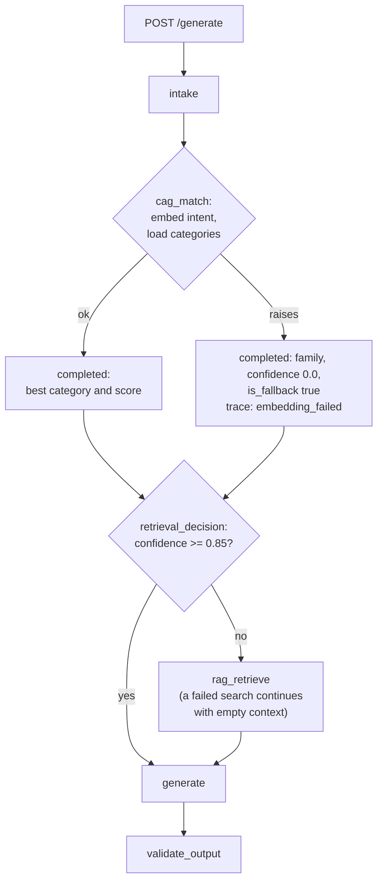
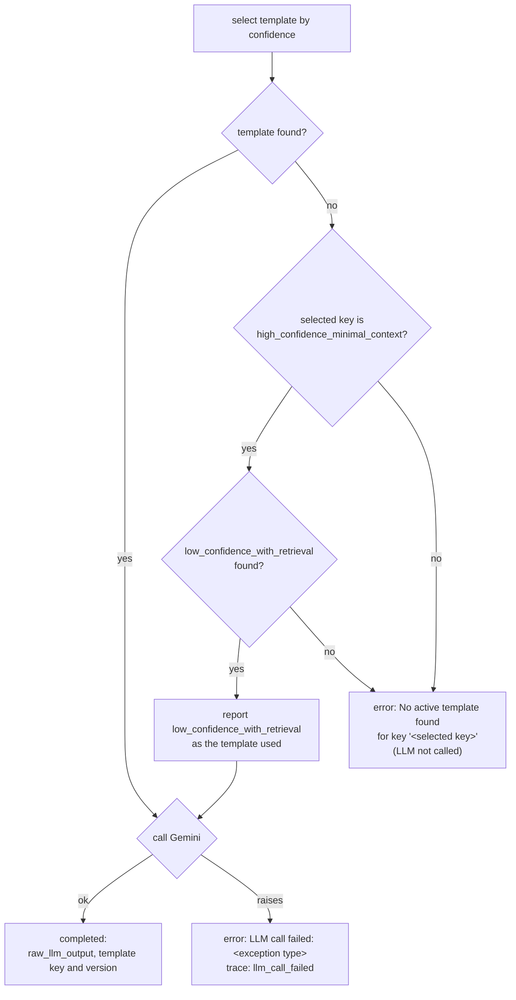
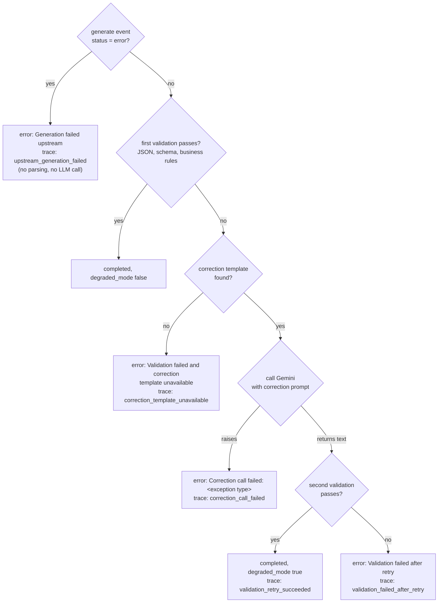

# API Reference

Base URL: `http://localhost:8000`

---

## Endpoints

| Method | Path | Description |
|--------|------|-------------|
| `GET` | `/health` | Liveness probe |
| `POST` | `/generate` | Run the travel itinerary workflow, stream results as SSE |
| `GET` | `/traces/{session_id}` | Fetch persisted trace events for a session |
| `GET` | `/` | Static frontend (HTML) |

---

## GET /health

Returns `200 OK` when the server is running.

```json
{ "status": "ok" }
```

---

## POST /generate

Executes the 6-step CAG + RAG travel itinerary workflow and streams one Server-Sent Event per step.

### Request

**Content-Type:** `application/json`

**Query parameters**

| Parameter | Type | Required | Description |
|-----------|------|----------|-------------|
| `template_version` | integer | No | Pin a specific prompt template version. Omit to use the active version. |

**Body**

| Field | Type | Required | Constraints |
|-------|------|----------|-------------|
| `destination` | string | Yes | Non-empty. Normalised to lowercase + stripped. |
| `trip_length` | integer | Yes | >= 1 |
| `budget` | string | Yes | One of `"budget"`, `"moderate"`, `"luxury"` |
| `travel_style` | string | Yes | Non-empty free text (e.g. `"family"`, `"adventure"`) |

**Example**

```json
{
  "destination": "Sydney",
  "trip_length": 3,
  "budget": "moderate",
  "travel_style": "cultural"
}
```

With version pin:

```
POST /generate?template_version=1
```

### Response

**Content-Type:** `text/event-stream`

The response body is a stream of SSE `data:` lines. Each line is a JSON object. The stream emits one event per workflow step in this order:

1. `intake`
2. `cag_match`
3. `retrieval_decision`
4. `rag_retrieve` _(only when confidence score < 0.85)_
5. `generate`
6. `validate_output`

### SSE event envelope

Every event shares the same outer shape:

```json
{
  "session_id": "xxxxxxxx-xxxx-xxxx-xxxx-xxxxxxxxxxxx",
  "step":       "<step name>",
  "status":     "completed" | "error",
  "timestamp":  "2026-04-08T04:12:01.123456+00:00",
  "data":       { ... },
  "error":      null | "<error message>"
}
```

| Field | Type | Notes |
|-------|------|-------|
| `session_id` | string (UUID) | Unique ID for this request. Present on every event. |
| `step` | string | Step name. See per-step sections below. |
| `status` | string | `"completed"` or `"error"` |
| `timestamp` | string (ISO 8601) | UTC timestamp when the event was emitted. |
| `data` | object | Step-specific payload. |
| `error` | string \| null | Error detail when `status` is `"error"`, otherwise `null`. |

---

### Step events — `data` field contents

#### `intake`

Input fields after normalisation and validation.

```json
{
  "session_id": "xxxxxxxx-xxxx-xxxx-xxxx-xxxxxxxxxxxx",
  "step":       "intake",
  "status":     "completed",
  "timestamp":  "2026-04-08T04:12:01.123456+00:00",
  "data": {
    "destination":   "sydney",
    "trip_length":   3,
    "budget":        "moderate",
    "travel_style":  "cultural"
  },
  "error": null
}
```

#### `cag_match`

Result of embedding-based intent classification against `itinerary_categories`.

```json
{
  "session_id": "xxxxxxxx-xxxx-xxxx-xxxx-xxxxxxxxxxxx",
  "step":       "cag_match",
  "status":     "completed",
  "timestamp":  "2026-04-08T04:12:02.234567+00:00",
  "data": {
    "matched_category":  "cultural",
    "confidence_score":  0.91,
    "tone":              "curious and immersive",
    "constraints":       "Prioritise museums, galleries, heritage sites, performing arts, and Indigenous cultural experiences.",
    "is_fallback":       false
  },
  "error": null
}
```

| Field | Type | Notes |
|-------|------|-------|
| `matched_category` | string | `category_key` of the best-matching row |
| `confidence_score` | float | Cosine similarity score, 0.0–1.0 |
| `tone` | string | Tone hint from the matched category |
| `constraints` | string | Constraint hint from the matched category |
| `is_fallback` | boolean | `true` when no match exceeded the minimum threshold and the default category was used |

If the embedding call or loading the categories fails, the step still completes with `matched_category` = `"family"`, `confidence_score` = `0.0` and `is_fallback` = `true`, so the request takes the retrieval path; the trace row records `error_type` = `"embedding_failed"`.

#### `retrieval_decision`

Routing decision based on the confidence threshold (0.85).

```json
{
  "session_id": "xxxxxxxx-xxxx-xxxx-xxxx-xxxxxxxxxxxx",
  "step":       "retrieval_decision",
  "status":     "completed",
  "timestamp":  "2026-04-08T04:12:02.345678+00:00",
  "data": {
    "routing_decision":  "generate",
    "confidence_score":  0.91,
    "threshold":         0.85
  },
  "error": null
}
```

| `routing_decision` | Meaning |
|--------------------|---------|
| `"rag_retrieve"` | Confidence was below threshold; the RAG step will run |
| `"generate"` | Confidence was at or above threshold; RAG step is skipped |

#### `rag_retrieve`

_(Only present when `routing_decision` is `"rag_retrieve"`.)_

Top-k source document chunks retrieved from PgVector.

```json
{
  "session_id": "xxxxxxxx-xxxx-xxxx-xxxx-xxxxxxxxxxxx",
  "step":       "rag_retrieve",
  "status":     "completed",
  "timestamp":  "2026-04-08T04:12:03.456789+00:00",
  "data": {
    "retrieved_context": [
      {
        "destination": "Sydney",
        "title":       "Guide to Sydney",
        "chunk_text":  "Sydney is located in New South Wales on traditional lands of the Gadigal people (Eora Nation). Key landmarks include Sydney Harbour Bridge and Opera House. Multiple beaches including Bondi offer year-round swimming..."
      }
    ],
    "chunks_retrieved":  5,
    "query_text":        "cultural travel in sydney cultural itinerary"
  },
  "error": null
}
```

| Field | Type | Notes |
|-------|------|-------|
| `retrieved_context` | array | List of chunk objects. Empty array if retrieval failed (graceful degradation). |
| `chunks_retrieved` | integer | Number of chunks returned |
| `query_text` | string | The query string sent to the vector search |

#### `generate`

Raw LLM response and the prompt template that was used.

```json
{
  "session_id": "xxxxxxxx-xxxx-xxxx-xxxx-xxxxxxxxxxxx",
  "step":       "generate",
  "status":     "completed",
  "timestamp":  "2026-04-08T04:12:06.567890+00:00",
  "data": {
    "raw_llm_output":          "{ \"destination\": \"sydney\", ... }",
    "prompt_template_key":     "high_confidence_minimal_context",
    "prompt_template_version": 1
  },
  "error": null
}
```

| Field | Type | Notes |
|-------|------|-------|
| `raw_llm_output` | string | Raw text from the LLM before validation |
| `prompt_template_key` | string | `"high_confidence_minimal_context"` or `"low_confidence_with_retrieval"` |
| `prompt_template_version` | integer | The version of the template that was resolved |

On error (template not found):

```json
{
  "session_id": "xxxxxxxx-xxxx-xxxx-xxxx-xxxxxxxxxxxx",
  "step":       "generate",
  "status":     "error",
  "timestamp":  "2026-04-08T04:12:06.567890+00:00",
  "data":       {},
  "error":      "No active template found for key 'high_confidence_minimal_context'"
}
```

If the selected template is missing but `low_confidence_with_retrieval` exists, that template is used and reported in `prompt_template_key` / `prompt_template_version`.

On error (LLM call failed) the event has the same shape, with `"error": "LLM call failed: <exception type>"`. Only the exception type is included; details stay in the server log.

#### `validate_output`

Validated and structured itinerary. This is the final consumable output.

```json
{
  "session_id": "xxxxxxxx-xxxx-xxxx-xxxx-xxxxxxxxxxxx",
  "step":       "validate_output",
  "status":     "completed",
  "timestamp":  "2026-04-08T04:12:07.678901+00:00",
  "data": {
    "itinerary": {
      "destination":             "sydney",
      "trip_length_days":        3,
      "budget_level":            "moderate",
      "travel_style":            "cultural",
      "daily_itinerary": [
        {
          "day":                   1,
          "morning":               "Visit the Sydney Opera House and join a guided backstage tour.",
          "afternoon":             "Walk across the Harbour Bridge and explore The Rocks heritage precinct.",
          "evening":               "Dinner at a waterfront restaurant in Circular Quay.",
          "estimated_cost_aud":    180.0
        },
        {
          "day":                   2,
          "morning":               "Aboriginal Bush Tucker Tour at the Royal Botanic Gardens.",
          "afternoon":             "Art Gallery of NSW — permanent collection and Aboriginal art wing.",
          "evening":               "Live performance at the Sydney Opera House.",
          "estimated_cost_aud":    160.0
        },
        {
          "day":                   3,
          "morning":               "Coastal walk from Bondi Beach to Coogee.",
          "afternoon":             "Sydney Jewish Museum or Museum of Sydney.",
          "evening":               "Dinner in Surry Hills.",
          "estimated_cost_aud":    140.0
        }
      ],
      "total_estimated_cost_aud": 480.0,
      "key_tips": [
        "Book Opera House tours and performances well in advance.",
        "The Opal card covers trains, buses, and ferries — buy one at the airport on arrival.",
        "Many galleries have free entry; check before paying at the door."
      ]
    },
    "degraded_mode": false
  },
  "error": null
}
```

`degraded_mode: true` means the first LLM response failed validation and a corrective retry was needed — the itinerary is still valid but was produced on the second attempt.

On unrecoverable error (both attempts failed):

```json
{
  "session_id": "xxxxxxxx-xxxx-xxxx-xxxx-xxxxxxxxxxxx",
  "step":       "validate_output",
  "status":     "error",
  "timestamp":  "2026-04-08T04:12:07.678901+00:00",
  "data":       { "degraded_mode": true },
  "error":      "Validation failed after retry: ..."
}
```

Other `validate_output` errors, all with `"data": { "degraded_mode": true }`:

| `error` | Cause |
|---------|-------|
| `"Generation failed upstream"` | The `generate` event has `status` = `"error"`; nothing is validated and no correction call is made |
| `"Correction call failed: <exception type>"` | The first validation failed and the correction LLM call raised |
| `"Validation failed and correction template unavailable: ..."` | The first validation failed and no `validate_output_correction` template is active |

---

### Error responses

| HTTP status | Cause |
|-------------|-------|
| `422 Unprocessable Entity` | Request body failed validation (missing field, invalid `budget` value, `trip_length < 1`, empty string). |
| `500 Internal Server Error` | `DATABASE_URL` environment variable is not set. |

---

### Failure behaviour

Once the request body is valid, a failure inside the workflow never breaks the stream: every request ends with a `validate_output` event. To find the cause of a failed request, look for the first event with `status` = `"error"`; the trace rows (`GET /traces/{session_id}`) carry the matching `error_type`. Error messages name only the exception type; the full exception is in the server log.

#### Overview and `cag_match`



An embedding failure is treated as "no match": confidence 0.0 sends the request down the retrieval path.

#### `generate`



#### `validate_output`



"Validation" means JSON parsing, the `ItineraryOutput` schema, and the business rules: the day count (internally and against the requested `trip_length`), daily costs adding up to the total, the total within the request's daily budget ceiling times the days, and no opening hours or prices in the text that the retrieved chunks do not state. A failed rule is reported in the correction prompt and, if the correction also fails, in `error` (messages begin `Content guardrail failed:` or `Business rule failed: cost` / `budget` / `unsupported`).

Every `validate_output` error event has `"data": { "degraded_mode": true }`. A reply blocked by Gemini's safety filter arrives as empty text, not as an exception, so it ends as "Validation failed after retry".

#### Event sequences

| Situation | `cag_match` | `generate` | `validate_output` |
|---|---|---|---|
| Everything works | completed | completed | completed, `degraded_mode` false |
| Gemini fails during embedding | completed (fallback, `embedding_failed`) | completed | completed |
| Gemini fails during generation (429, 503, network) | completed | error: `LLM call failed: ClientError` | error: `Generation failed upstream` |
| No active template | completed | error: `No active template found for key ...` | error: `Generation failed upstream` |
| First output invalid (schema or a business rule), correction valid | completed | completed | completed, `degraded_mode` true |
| First output invalid, correction call fails | completed | completed | error: `Correction call failed: ServerError` |
| First output and correction both invalid | completed | completed | error: `Validation failed after retry: ...` |

---

## GET /traces/{session_id}

Returns all `trace_events` rows written during a workflow run, ordered by `created_at` ascending.

### Path parameters

| Parameter | Type | Description |
|-----------|------|-------------|
| `session_id` | string (UUID) | The `session_id` from any SSE event in the stream. |

### Response

**Content-Type:** `application/json`

```json
[
  {
    "session_id":               "xxxxxxxx-xxxx-xxxx-xxxx-xxxxxxxxxxxx",
    "step_name":                "intake",
    "status":                   "completed",
    "latency_ms":               12.4,
    "prompt_template_key":      null,
    "prompt_template_version":  null,
    "degraded_mode":            null,
    "error_type":               null,
    "created_at":               "2026-04-08T04:12:01.123456"
  },
  {
    "session_id":               "xxxxxxxx-xxxx-xxxx-xxxx-xxxxxxxxxxxx",
    "step_name":                "generate",
    "status":                   "completed",
    "latency_ms":               3201.7,
    "prompt_template_key":      "high_confidence_minimal_context",
    "prompt_template_version":  1,
    "degraded_mode":            null,
    "error_type":               null,
    "created_at":               "2026-04-08T04:12:04.331234"
  }
]
```

| Field | Type | Notes |
|-------|------|-------|
| `step_name` | string | One of the 6 workflow step names |
| `status` | string | `"completed"`, `"error"`, or `"running"` |
| `latency_ms` | float | Wall-clock duration of the step in milliseconds |
| `prompt_template_key` | string \| null | Set only for the `generate` step |
| `prompt_template_version` | integer \| null | Set only for the `generate` step |
| `degraded_mode` | boolean \| null | Set only for the `validate_output` step |
| `error_type` | string \| null | Machine-readable classification of what went wrong, or `null`. Usually set with `status` = `"error"` (`llm_call_failed` for `generate`; `correction_call_failed`, `upstream_generation_failed`, `correction_template_unavailable`, `validation_failed_after_retry` for `validate_output`), but also on some completed steps: `embedding_failed` (`cag_match` fell back to the default category) and `validation_retry_succeeded` (`validate_output`) |
| `created_at` | string (ISO 8601) | Row insertion timestamp |

### Error responses

| HTTP status | Cause |
|-------------|-------|
| `404 Not Found` | No trace rows exist for the given `session_id`. |
| `500 Internal Server Error` | `DATABASE_URL` environment variable is not set. |
